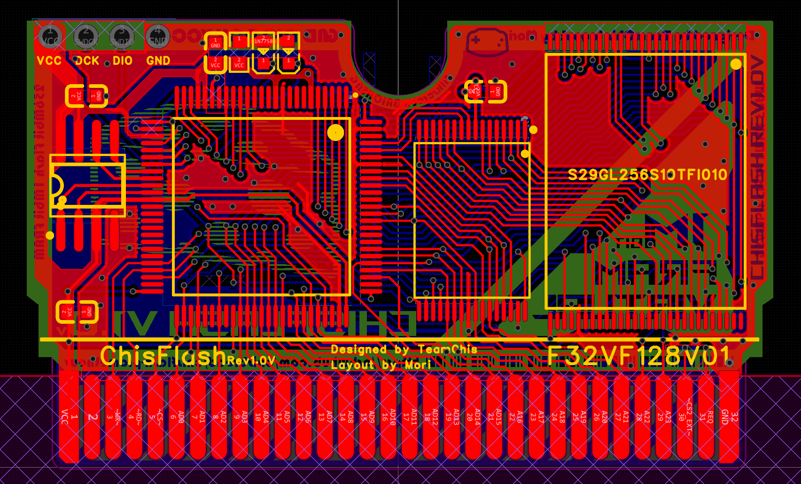

# ChisFlash 1.0V 虚拟铁电即时存档卡

一款基于 ChisFlash 虚拟铁电方案的 GBA 卡带改版。卡带使用并口 NOR Flash 保存游戏数据，并通过虚拟铁电存档方案实现断电保存；安装外置 **4M SRAM** 后，还可以为支持对应补丁的游戏提供 RTS（即时存档）快速缓存。



## 功能特点

- 支持 **32MB NOR Flash**，芯片型号为 `S29GL256S10TFI010`。
- 不安装外置 4M SRAM 时，可以作为普通虚拟铁电卡使用。
- 安装外置 4M SRAM 后，支持 RTS 即时存档快速缓存。
- 配合 Ausar 的 RTS + 金手指专用补丁，可以在游戏中呼出暂停菜单，进行即时存档和金手指操作。
- 针对普通虚拟铁电卡使用 `S29GL256S` 时部分游戏可能花屏的问题进行了改进。
- 固件可以使用 DAPLink 通过 SWD 烧录，也可以使用 AG32 专用烧录器烧录。

## 固件

当前目录只提供已编译固件，暂不提供固件源码：

| 文件 | 说明 |
|---|---|
| [`ChisFlash-1.0V-Virtual-Iron-4M+1M-External-SRAM-RTS.bin`](firmware/ChisFlash-1.0V-Virtual-Iron-4M+1M-External-SRAM-RTS.bin) | 外置 SRAM + RTS 版本 |
| [`ChisFlash-1.0V-Virtual-Iron-4M+1M-No-External-SRAM.bin`](firmware/ChisFlash-1.0V-Virtual-Iron-4M+1M-No-External-SRAM.bin) | 无外置 SRAM 版本 |

刷写前请确认硬件焊接方式和固件版本匹配。不同版本固件不要混用。

## 使用 RTS 功能

1. 按硬件配置焊接或安装外置 SRAM。
2. 刷入对应固件。
3. 使用 [GBA RTS + 金手指专用补丁](https://archeychen.github.io/GBA-RTS-PATCH-WEB/) 处理需要 RTS 的游戏 ROM。
4. 使用兼容的 GBA 烧录器烧录处理后的 ROM。
5. 进入游戏后按补丁说明呼出暂停菜单，执行即时存档或金手指操作。

没有外置 SRAM 时，使用无外置 SRAM 固件，并按普通虚拟铁电卡方式使用。

## 项目文件

```text
ChisFlash-1.0V-main/
├── firmware/       已编译固件
├── hardware/
│   ├── pcb/        ProDoc PCB 工程
│   └── gerber/     Gerber 生产文件
├── images/         PCB 预览图
└── README.md
```

## BOM 摘要

| 器件 | 数量 | 备注 |
|---|---:|---|
| `S29GL256S10TFI010` | 1 | NOR Flash，32MB |
| `100nF` | 4 | 去耦电容 |
| `NCD0603B1` | 1 | LED |
| `NCD0603G1` | 1 | LED |
| `1kΩ` | 1 | 电阻 |

完整生产文件见 [`hardware/gerber/`](hardware/gerber/)，PCB 工程见 [`hardware/pcb/`](hardware/pcb/)。下单前请自行检查元件、封装、板层和焊接条件。

## 更新记录

- **2025-10-22**：更新基础固件，可作为普通虚拟铁电卡使用；外置 4M SRAM 功能当时尚未实装。
- **2026-04-28**：更新即时存档固件，支持 Ausar 最新 RTS + 金手指专用补丁，可在游戏中呼出暂停菜单进行即时存档和金手指操作。

## 鸣谢

感谢 PCB 和固件开发者 **mori**、RTS 专用补丁开发者 **Ausar**，以及 ChisFlash 社群中参与测试和反馈的朋友们。

项目页面标注 **GPL-3.0**。商业使用、售卖和二次发布请同时遵守项目作者在原项目页面中的说明；复刻前请自行验证电路和硬件适配性。
